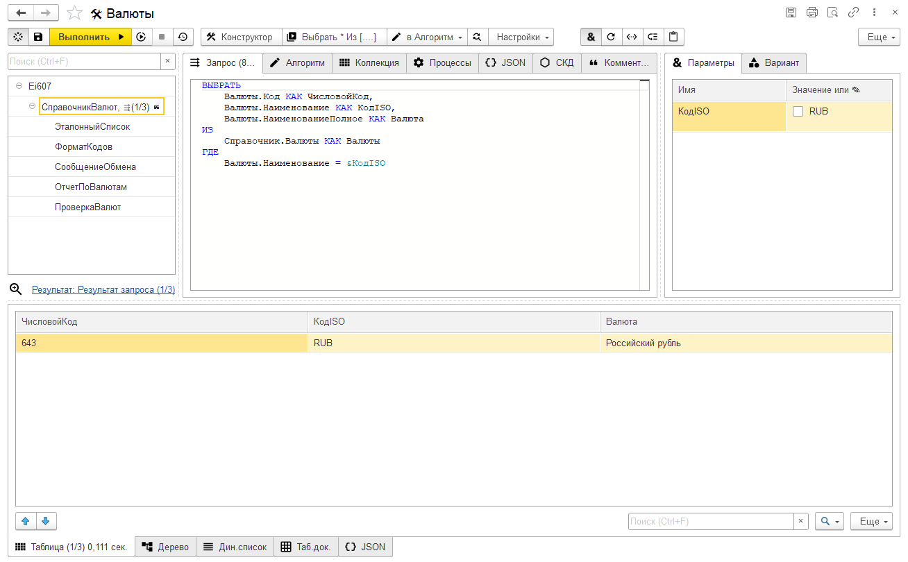
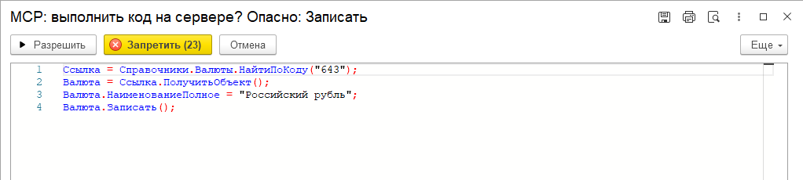
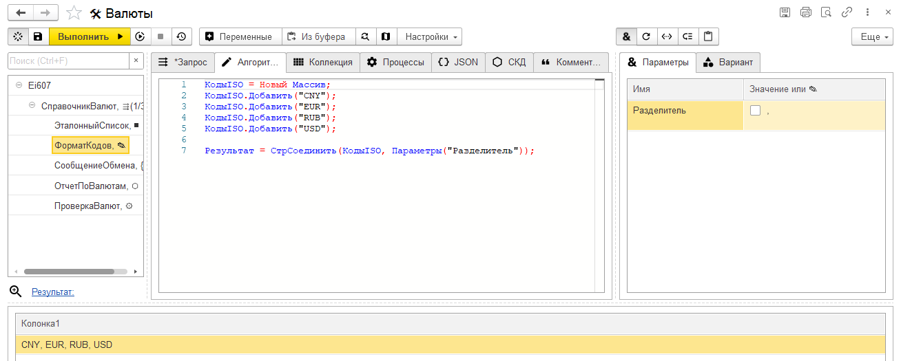
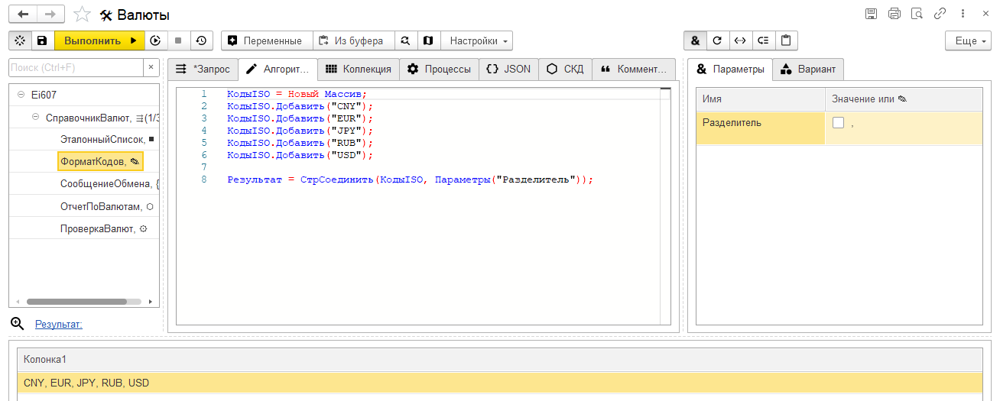

# Ei (Enterprise Intelligence)

Ei даёт ИИ-агенту и разработчику общий рабочий набор в 1С. Агент пишет запросы и код, а разработчик видит, из каких шагов состоит решение, проверяет его на данных базы и при необходимости правит. Тот же набор можно открыть в EDT для отладки.

## Рекомендуемое окружение

- **В базе 1С** установите Ei и расширение `1c_mcp`. Подключите ИИ-помощника к этой базе через MCP и войдите в клиент 1С под тем же пользователем. Тогда наборы и запросы на подтверждение будут приходить в ваш сеанс. [Установка 1c_mcp](https://github.com/German09/1c_mcp)
- **В 1С:EDT** откройте исходники набора. Если помощнику нужен доступ к метаданным конфигурации и коду в EDT, подключите к нему также [EDT-MCP](https://github.com/DitriXNew/EDT-MCP).

## От задачи в чате до проверки в 1С

1. Попросите ИИ-помощника подготовить набор. Например, «Пришли в Ei проверку справочника валют с запросом по коду ISO и эталонным списком».
2. Нажмите на оповещение **«Консоль»** в 1С. Проверьте шаги и при необходимости добавьте отбор в запросе или измените алгоритм прямо в Ei. Запустите нужный вариант и проверьте результат.
3. Попросите агента перечитать набор. Он получит ваш актуальный код и параметры, включая несохранённые правки, а также результаты последних запусков.

**Клиентский код из MCP.** Агент может выполнять код в уже открытом клиенте 1С пользователя через Ei. Это даёт ему доступ к клиентским операциям, например к открытию формы и работе с её реквизитами.

**Согласование записи в базу.** Когда код с опасными конструкциями, например записью объектов, требует подтверждения, Ei показывает отдельное оповещение. Откройте его, проверьте, что именно изменит код, и разрешите или запретите запуск.

## Просмотр данных в 1С

Попросите агента вывести результат в Ei, если выборка большая или вам нужны исходные значения. При подключении через сервер анонимизации агент может получить замаскированные значения, а большие выборки занимают много контекста. В Ei вы разбираете данные из базы прямо в 1С и при необходимости передаёте агенту нужный срез или итоги.

- [Таблица результата](docs/result-table.md) показывает вложенные таблицы рядом со сводкой. При выборе строки детали обновляются.
- [Форма выбора](docs/value-picker.md) раскрывает связанные данные в дереве. Так можно посмотреть реквизиты ссылки, поля структуры и содержимое вложенных коллекций.

## Из 1С в EDT и обратно

1. В Ei нажмите **Сохранить как** и выберите каталог. Набор сохранится как исходники внешней обработки EDT.
2. Откройте обработку в EDT и оставьте тот же набор открытым в Ei. **Сохранили правку в EDT - она автоматически появится в Ei.** Если тот же фрагмент изменён и в Ei, программа спросит, загрузить ли версию с диска.
3. Для отладки поставьте точку останова в EDT и запустите алгоритм из Ei в сеансе 1С под отладкой. При готовой сборке, которая соответствует исходникам, Ei выполнит код из неё.

На втором снимке в том же открытом Ei появилась строка с `JPY`, сохранённая в EDT. После запуска новый код валюты виден и в результате.

| До сохранения в EDT | После сохранения в EDT и запуска в Ei |
| --- | --- |
|  |  |

Если Ei сообщает, что отслеживание файлов недоступно, используйте команду **Перечитать**. Готовый файл `.epf` можно открыть в Ei и восстановить из него исходники для EDT.

## Инструменты набора

В одной строке набора можно сочетать несколько вариантов, например запрос по коду ISO и комментарий с ожидаемым результатом. У вариантов одной строки общие параметры.

| Инструмент | Когда использовать |
| --- | --- |
| [Запрос](docs/query.md) | Получить данные из базы одним запросом или пакетом. |
| [Алгоритм](docs/algorithm.md) | Выполнить код 1С, например сравнить результаты двух запросов. |
| [Коллекция](docs/collection.md) | Подготовить редактируемую таблицу для запроса, алгоритма или процесса. |
| [Процессы](docs/processes.md) | Связать шаги на схеме и при необходимости повторить их для каждой строки. |
| [СКД](docs/dcs.md) | Выполнить схему компоновки данных и проверить группировки, отборы и итоги. |
| [JSON](docs/json.md) | Хранить и редактировать пример сообщения обмена или входных данных. |
| [Комментарий](docs/comment.md) | Описать назначение шага, ожидаемый результат и ссылки на связанные шаги. |

[Фоновый запуск](docs/background.md) доступен для запросов, алгоритмов и процессов. Пока задание выполняется на сервере, можно работать с другими строками набора. По завершении Ei показывает оповещение.
