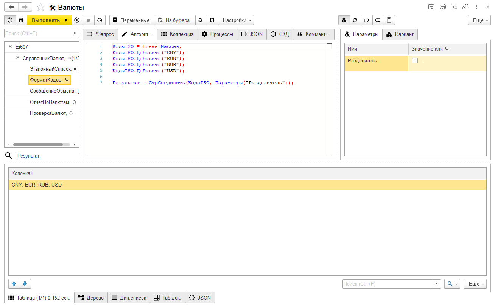

# Алгоритм

[К списку инструментов](../README.md#инструменты-набора)

Выполняйте код на встроенном языке 1С. На снимке алгоритм соединяет коды валют строкой-разделителем из параметров.

- Значения из панели **Параметры** доступны в коде через `Параметры("Имя")`. Для вывода значения присвойте его переменной `Результат`.
- Команда **Переменные** открывает [форму выбора](value-picker.md), в которой можно раскрыть параметры и результаты других вариантов.
- Длительный серверный алгоритм можно запустить [в фоне](background.md).
- Для отладки откройте исходники набора в EDT и поставьте точку останова в коде. Запустите полный алгоритм из Ei в сеансе 1С под отладкой, когда сборка EDT соответствует сохранённым исходникам.

