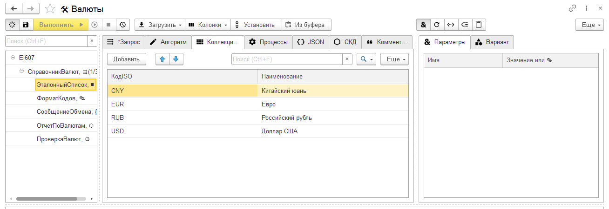

# Коллекция

[К списку инструментов](../README.md#инструменты-набора)

Сохраните в наборе редактируемую таблицу. На снимке коллекция содержит эталонный список кодов и названий валют.

- Колонки и их типы задаются в структуре коллекции. Данные можно ввести вручную, вставить из буфера обмена или загрузить из результата другого шага.
- Передайте коллекцию [алгоритму](algorithm.md) или используйте её как источник для шага **Для Каждого** в [процессе](processes.md).

