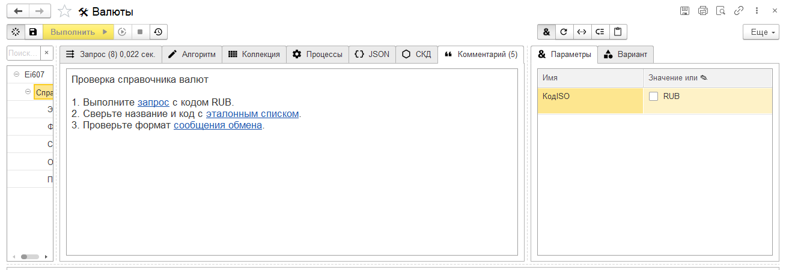

# Комментарий

[К списку инструментов](../README.md#инструменты-набора)

Запишите прямо в наборе, зачем нужен шаг и какой результат считать правильным. На снимке комментарий объясняет, как сверить валюту с эталонным списком.

Добавьте ссылки на связанные строки набора, чтобы переходить к ним прямо из комментария.

