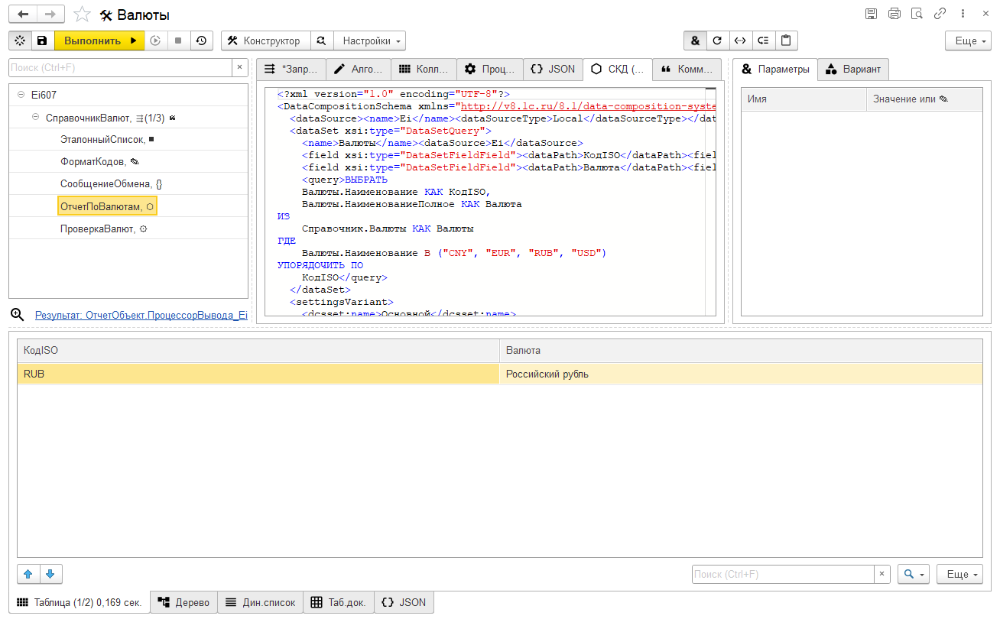

# СКД

[К списку инструментов](../README.md#инструменты-набора)

Выполняйте схему компоновки данных в Ei. На снимке показаны текст схемы и результат компоновки по справочнику валют.

- Укажите схему, задайте параметры в строке набора и нажмите **Выполнить**.
- Конструктор СКД в Ei открывается в толстом клиенте 1С. В тонком и веб-клиенте схему можно редактировать в виде текста.

