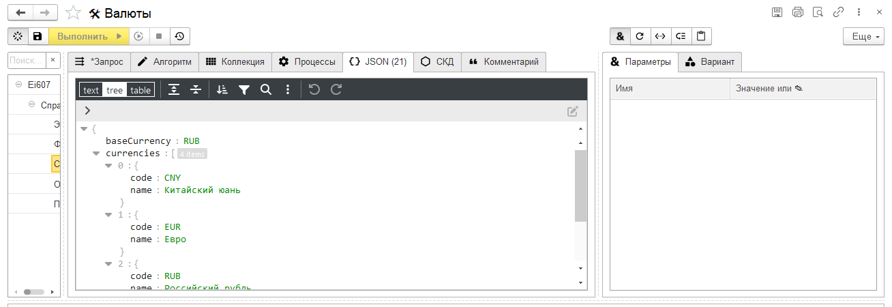

# JSON

[К списку инструментов](../README.md#инструменты-набора)

Храните и редактируйте JSON рядом с шагами, которые с ним работают. На снимке сообщение с базовой валютой и списком валют открыто в режиме дерева.

В редакторе можно переключаться между текстом, деревом и таблицей. Для обработки содержимого используйте [алгоритм](algorithm.md).

Ei использует сборку `vanilla-jsoneditor` из проекта JSON. [Репозиторий сборки](https://github.com/German09/json) · [Исходная библиотека svelte-jsoneditor](https://github.com/josdejong/svelte-jsoneditor)
