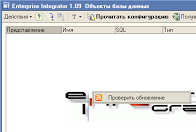

# Enterprise Integrator для 1С 8.2

Enterprise Integrator (Ei) создавался как набор инструментов для разработки и сопровождения решений на платформе «1С:Предприятие 8». Проект развивался с 2006 года. В одной обработке можно было собрать запрос, разобрать результат, изучить работу запроса на уровне СУБД и перейти к объекту конфигурации, с которым связаны данные.

Этот раздел основан на справке старого сайта проекта. Он описывает интерфейс и возможности раннего Ei. Руководство по современной версии находится в [основном README](../../README.md).

## Инструменты

| Раздел | Что в нём было |
| --- | --- |
| [Конструктор запросов и обработок](console.md) | Запросы 1С, СКД, встроенный язык, SQL, общие параметры и обработка результата. |
| [ProFiler и технологический журнал](profiler.md) | Настройка и запуск трассировки, чтение событий в реальном времени и просмотр планов запросов. |
| [Объекты базы данных и конфигурации](objects.md) | Связь метаданных 1С с таблицами СУБД, индексы, секционирование, сравнение модулей и макетов. |

## Архивный выпуск

[Enterprise Integrator 2.62 для 1С 8.2](https://github.com/German09/Ei/releases/tag/legacy-v2.62) содержит внешнюю обработку `EI_82 2.62.epf`. В старой документации часть функций описывалась для редакции с аппаратным ключом. Сведения о редакциях и системных требованиях относятся к тому периоду.

5 ноября 2013 года версия 2.62 вышла как бета-версия. В ней дерево объектов базы данных стало формироваться по мере раскрытия узлов, а ProFiler получил интерактивный план запросов Microsoft SQL Server. План можно было открыть и отдельно из файла `.txt` (формат 1С) или `.xml` (формат SQL Server). [Исторический список выпусков в Google Code Archive](https://code.google.com/archive/p/enterprise-integrator/downloads)

О проекте того времени также рассказывают [статья об индексах и секциях](https://infostart.ru/1c/articles/98628/) и [доклад о технологическом журнале на INFOSTART EVENT 2012](https://infostart.ru/1c/articles/162790/).
