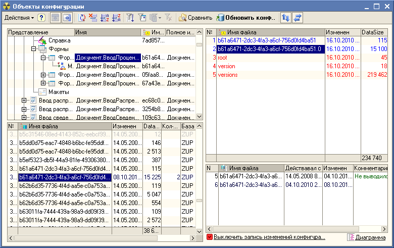
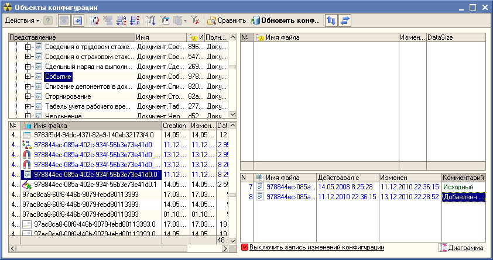
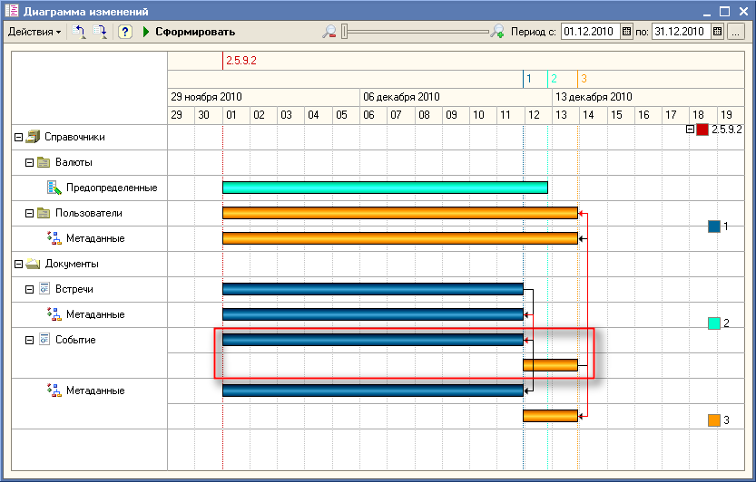

# Объекты и хранилище конфигурации

[К архивному руководству](README.md)

В этом инструменте можно было найти объект метаданных, открыть его модуль, форму или макет, сопоставить версии и перенести выбранные изменения. Дерево объектов было связано с тремя таблицами: конфигурацией базы данных (`Config`), основной конфигурацией (`ConfigSave`) и историей изменений. При выборе элемента в дереве окно показывало соответствующие записи. Если основная конфигурация совпадала с конфигурацией базы, отдельная таблица основной конфигурации скрывалась.

## Просмотр и сравнение

Для сравнения можно было выбрать две записи из любых таблиц, например текущую конфигурацию и версию из истории. Для форм дополнительно выбирался сравниваемый раздел. Ei умел открывать тексты модулей и справки, табличные документы, XML и HTML. Для обычных форм отдельно показывались модуль и описание формы. По описанию можно было построить предварительный вид формы либо получить выражение для создания её элементов на встроенном языке.

При соответствующей настройке в список также попадали записи аналогичных конфигураций из других баз на том же сервере СУБД. Выбранную запись можно было скопировать в основную конфигурацию для последующей работы в конфигураторе.

## Хранилище Ei

По команде **Включить запись изменений конфигурации** Ei создавал собственное хранилище в таблице `Config_Depot`. Оно сохраняло версии элементов при изменениях из конфигуратора и Ei. Для выбранного элемента можно было открыть предыдущие версии, сравнить две записи, добавить комментарий или восстановить версию. По всей конфигурации строилась диаграмма истории за выбранный период. [Демонстрация хранилища на Инфостарте](https://infostart.ru/video/w168126/)

## Частичное обновление

Из формы объектов конфигурации можно было применить выбранные изменения без реструктуризации таблиц. Инструмент работал с записями конфигурации непосредственно в СУБД. Справка отдельно указывала, что изменения становились видны в конфигураторе после повторного открытия конфигурации.

Справка относила редактирование, хранилище и обновление конфигурации к редакции с аппаратным ключом.
