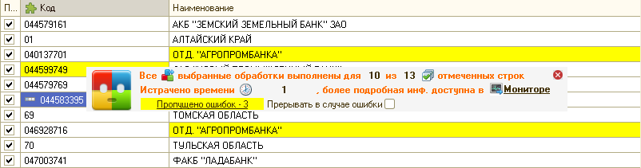

# Конструктор запросов и обработок

[К архивному руководству](README.md)

В конструкторе собирали набор связанных запросов и инструкций. Слева было дерево запросов, в центре редактор выбранной конструкции, внизу результат. Параметры открывались отдельной командой и использовались во всех блоках конструктора.

## Выполнение

- На закладке **Предприятие** можно было выполнить запрос на языке 1С, воспользоваться построителем запроса или запустить схему компоновки данных.
- На закладке **SQL** выполнялись прямые запросы к СУБД и внешним источникам. Отдельная закладка предназначалась для выражений и алгоритмов на встроенном языке 1С.
- Запросы в дереве использовали общий менеджер временных таблиц. Из контекстного меню можно было выполнить пакет, посмотреть данные выделенного источника, очистить временные таблицы или сформировать код 1С для выполнения запроса с параметрами. Справка также описывала трассировку и фоновое выполнение.
- Результат отображался в виде таблицы или дерева значений, табличного документа либо в OLAP-представлении через компоненту ActiveX. Конструктор поддерживал файлы консоли запросов `.sel` и консоли отчётов `.rcf`.

## Обработка результата

Из результата запроса или алгоритма можно было собрать цепочку действий для выбранных объектов. Элементы цепочки вкладывались друг в друга и выполнялись по условиям. Среди готовых действий были установка реквизитов, запись объектов, проведение и отмена проведения документов, установка и снятие пометки удаления.

Для загрузки данных предназначалась отдельная форма. В дереве объектов задавалось, что создавать или заполнять, а в таблице свойств сопоставлялись поля входных данных и реквизиты 1С. Источником служил результат конструктора, в том числе дерево значений. Элемент загрузки формировал объект или набор записей регистра, а запись выполнялась следующим действием цепочки.
