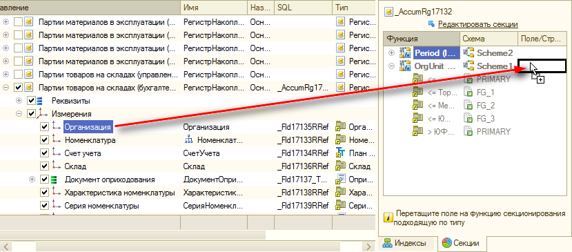

# Объекты базы данных

[К архивному руководству](README.md)

## От метаданных к физической таблице

Команда **Прочитать конфигурацию** строила дерево объектов, у которых есть представление в базе данных. Для элемента можно было сопоставить имя и синоним в конфигурации, имя таблицы или поля SQL, тип значения и назначение таблицы. Один объект 1С мог занимать несколько таблиц, например для основных данных, регистрации изменений и итогов. Отдельная команда получала параметры SQL, в том числе сведения об объёме данных.

## Индексы и секции

Для Microsoft SQL Server можно было просматривать отдельную сводку рекомендуемых индексов по всей базе и переходить из неё к конкретной таблице. Сводка показывала число поисков и просмотров, а также оценку выигрыша по статистике с момента запуска экземпляра СУБД. В карточке таблицы сравнивали рекомендации с существующими индексами. Поля индекса добавлялись из дерева объектов, там же можно было изменять состав и порядок ключевых полей.

Для секционирования задавали функцию с границами и схему, связывающую секции с файловыми группами. Границы можно было заполнить вручную или получить из интервала дат либо ссылок одного типа 1С. После назначения схемы таблице Ei показывал распределение данных по секциям.

Исторический инструмент умел менять физическую структуру базы. При изменении секционирования таблицы без кластерного индекса справка описывала создание новой таблицы с переносом данных.

## Таблицы, файлы и регистры

- На вкладке таблицы показывались параметры сжатия, эскалации блокировок и размещения данных.
- В дереве файловых групп были видны размеры файлов, объёмы чтения и записи и накопленные задержки. Из этой же формы можно было управлять файлами и группами.
- Для регистров накопления и бухгалтерии показывались настройки итогов, в том числе разделение итогов. Для оборотных регистров накопления отдельно отображались агрегаты.

[Объекты и хранилище конфигурации](configuration.md)
