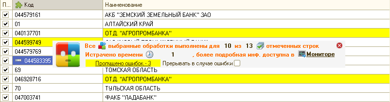

# Групповые обработки и загрузка данных

[К архивному руководству](README.md)

Из результата запроса или алгоритма можно было собрать цепочку действий для выбранных объектов. Слева в форме располагались выбранные обработки. Действия вкладывались друг в друга, а условие определяло, для каких строк выполнять очередной шаг. Таким образом, в одном наборе можно было сначала выбрать данные, а затем обработать их без подготовки отдельной внешней обработки.

## Что можно было сделать с результатом

- Установить реквизиты, записать объект или выполнить свой алгоритм.
- Провести документ, отменить проведение, установить или снять пометку удаления.
- Передать выполнение вложенной обработке. Среди доступных шагов были запись объекта и установка режима `ОбменДанными.Загрузка`.

Монитор показывал ход групповой обработки. В итоговом сообщении были видны количество обработанных строк, число пропущенных ошибок и время работы.

## Загрузка и преобразование данных

[Видео «Загрузка данных»](https://www.youtube.com/watch?v=YJcbME8dt94)

Загрузка создавала объекты и заполняла регистры по таблице или дереву результатов. Слева задавалось, какие объекты создавать и какие данные подчинены друг другу, справа сопоставлялись исходные поля с реквизитами, измерениями и ресурсами. Старая справка сравнивала этот подход с правилами конвертации данных. Источником мог быть результат импорта из внешнего файла через шаблон конструктора.

Загрузчик подготавливал объект или набор записей регистра в памяти. В цепочку можно было добавить отдельный шаг записи. Справка приводила примеры загрузки справочников, табличных частей, регистров сведений и накопления, а также редактирования регистров.
