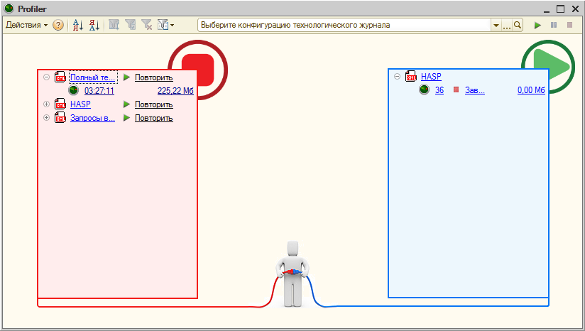
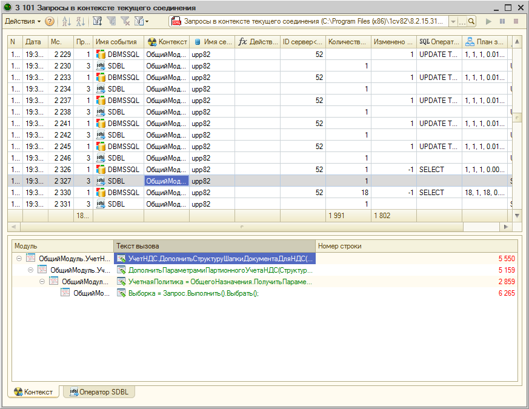
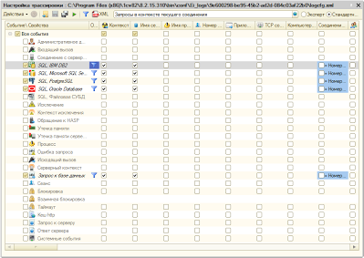
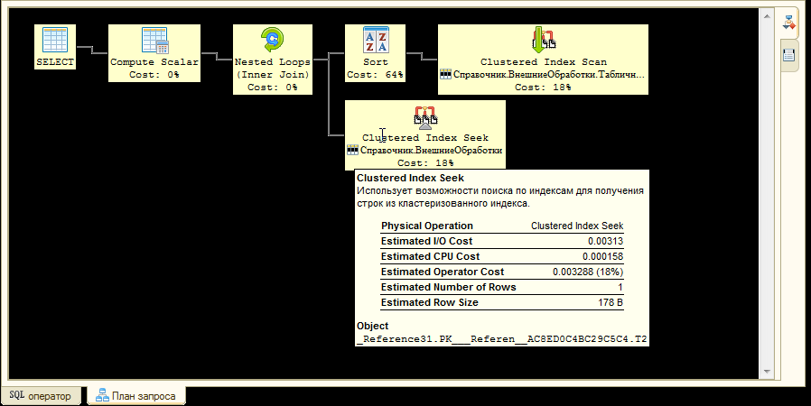

# ProFiler и технологический журнал

[К архивному руководству](README.md)

В ProFiler настраивали, запускали и останавливали технологический журнал 1С. Данные читались в фоне из завершённых и ещё работающих трассировок. В справке указывалась возможность одновременно читать до пяти журналов.

## Трассировка

В стартовом окне завершённые трассировки показывались слева, запущенные справа. Трассировки группировались по настройкам. Для каждой были видны объём собранных данных и длительность. В форме трассировки можно было выбрать событие в таблице и раскрыть его подробности.

Настройку журнала можно было открыть из XML-файла, изменить список событий и отборы, сохранить в файл или запустить сразу. В режиме Expert показывались сокращённые имена свойств и событий. XML-представление можно было просматривать и редактировать из той же формы.

## План запроса

Для плана запроса Microsoft SQL Server предусматривались две закладки. Одна показывала исходный текст плана, другая строила графическое HTML-представление. При наведении на оператор отображались подробности. Ссылки на таблицу, поле или индекс открывали соответствующий объект в [дереве объектов базы данных](objects.md).

