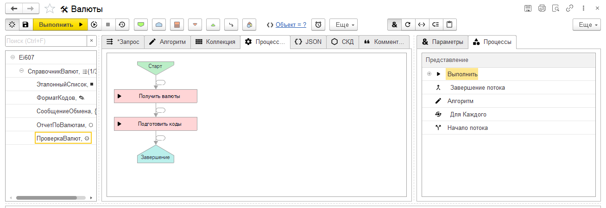

# Процессы

[К списку инструментов](../README.md#инструменты-набора)

Процесс выполняет шаги, соединённые линиями от **Старта** до **Завершения**. На снимке процесс сначала запускает запрос к справочнику валют, затем алгоритм форматирования кодов.

| Элемент | Как работает |
| --- | --- |
| **Выполнить** | Запускает выбранный вариант набора. В настройках укажите строку и вариант, например **Запрос** в строке «СправочникВалют». |
| **Алгоритм** | Выполняет код, заданный внутри самого шага. Например, вычисляет новый столбец или подготавливает данные для следующего шага. |
| **Для Каждого** | Выполняет вложенную схему для каждого элемента источника, например строки [коллекции](collection.md) или результата запроса. В первом шаге текущий элемент доступен через `Объект()`. Каждый элемент обрабатывается со своим контекстом. |
| **Начало потока** | Запускает исходящие ветки отдельными фоновыми заданиями. Используйте для независимых задач, которые можно выполнять параллельно. |
| **Завершение потока** | Ждёт окончания веток, собирает их результаты и сообщения. Следующие шаги идут после этой точки. |

В настройке **Объект** можно задать исходные данные процесса, а на линии перехода уточнить объект для следующего шага. К результату выполненного шага можно обратиться по имени через `Результат("ИмяШага")`.

Чтобы видеть ход длительного процесса и счётчик строк **Для Каждого**, запустите весь процесс [в фоне](background.md).
