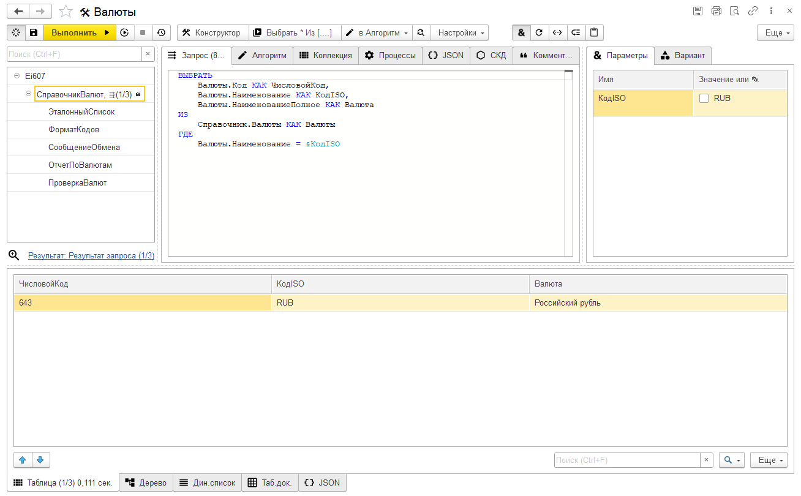

# Запрос

[К списку инструментов](../README.md#инструменты-набора)

Выполняйте запросы 1С к данным текущей базы. Например, найдите валюту по коду ISO и передайте выборку в [алгоритм](algorithm.md).

- Ei извлекает имена параметров из текста. На снимке для `&КодISO` задано значение `RUB`. После нажатия **Выполнить** [таблица результата](result-table.md) появляется под редактором.
- Для подготовки временных таблиц и итоговой выборки используйте пакет запросов в одном варианте. Длительный запрос можно запустить [в фоне](background.md).

