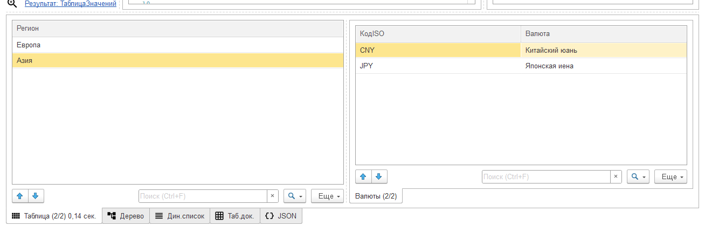

# Таблица результата

[К просмотру данных в Ei](../README.md#просмотр-данных-в-1с)

Результат запроса или алгоритма может содержать вложенные таблицы. Ei показывает сводку слева, а вложенную таблицу выбранной строки справа. Щёлкните по другой строке, чтобы увидеть её детали. У сводки и деталей свои поля поиска.

В примере алгоритм вернул регионы и таблицу валют для каждого региона. При выборе **Азия** справа видны `CNY` и `JPY`. Так можно проверить, какие детали попали в каждую группу результата.

