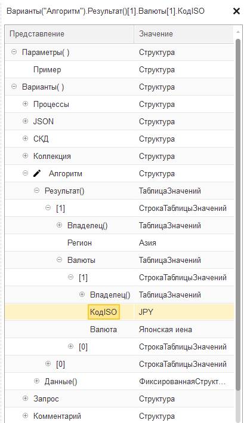

# Форма выбора

[К просмотру данных в Ei](../README.md#просмотр-данных-в-1с)

Откройте **Переменные** в [алгоритме](algorithm.md), чтобы увидеть доступные параметры, варианты и наборы. В дереве можно раскрывать реквизиты ссылок, поля структур и элементы коллекций. Это помогает понять, какие данные использует код, и найти нужное значение для следующего шага.

На снимке раскрыт путь **Варианты → Алгоритм → Результат → строка региона → Валюты**. Вверху формы виден путь к выбранному значению. В режиме выбора выражения Ei может подставить этот путь в параметр.

